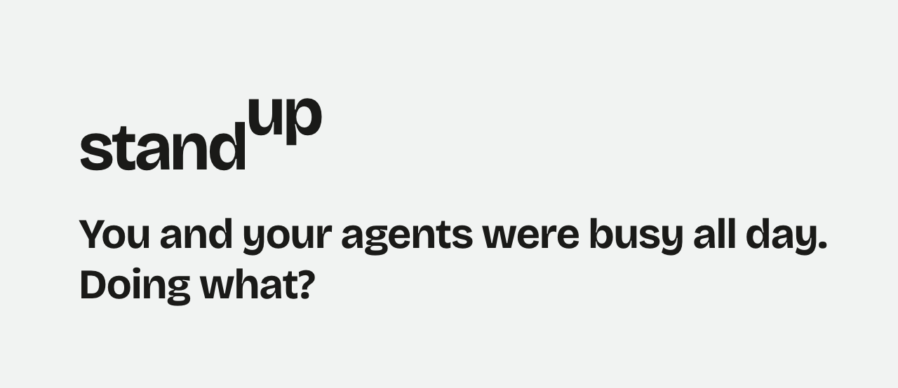
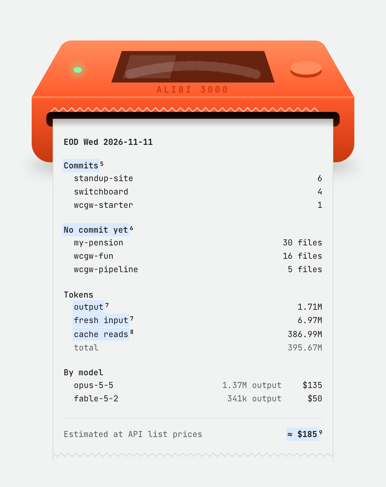
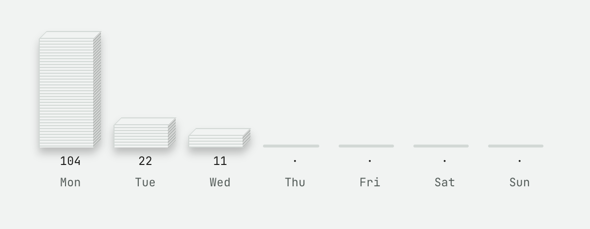
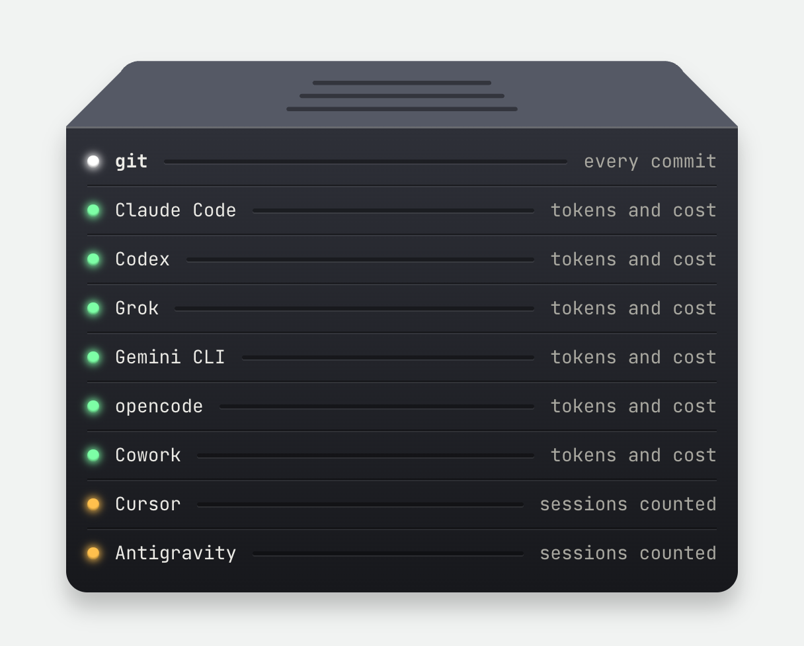

  <a href="https://standup.wcgw.fun">
    <picture>
      <source media="(prefers-color-scheme: dark)" srcset="docs/readme/hero-dark.png">
      
    </picture>
  </a>

  Standup reads your git commits and your agents' sessions and writes the end-of-day update you can no longer write from memory.

  
  
  
  

  <a href="#install">Install</a> ·
  <a href="#what-you-get">What you get</a> ·
  <a href="#what-it-reads">What it reads</a> ·
  <a href="plugin/README.md">Full reference</a> ·
  <a href="https://standup.wcgw.fun">Website</a>

## Install

Pick your agent, run one command, then say "write my standup update".

| Agent | Command |
| --- | --- |
| Claude Code | `/plugin install standup --marketplace wcgwhq/standup` |
| Codex | `codex plugin marketplace add wcgwhq/standup && codex plugin add standup@standup` |
| Cursor | `cursor-agent plugin marketplace add https://github.com/wcgwhq/standup`, then turn Standup on under Plugins |
| Gemini CLI | `gemini extensions install https://github.com/wcgwhq/standup` |
| Grok | `grok plugin install wcgwhq/standup#plugin --trust` |
| opencode | `git clone https://github.com/wcgwhq/standup ~/standup && cp -R ~/standup/plugin/skills/standup ~/.config/opencode/skills/` |

Any other agent that reads `SKILL.md` folders: same as opencode, copied into `~/.agents/skills/`.

It needs Python 3.9 or later and git, on macOS or Linux. There are no packages to install.

## What you get

Four to six lines you can say out loud. Paste them into Slack, say them at standup, or keep them as proof the day happened. This is a real one, from a day spent on this website:

> **Standup EOD Tuesday, November 17th, 2026**
>
> - **Standup Site** ✅ → a sun dial across the window with a sky behind the page, voice characters, a page per agent, and it deploys itself on every push
> - **wcgw.fun** 🔁 → four pull requests from Cursor merged: an Astro landing, an editorial manifesto, the WCGW mark in the masthead
> - **Standup Plugin** 🚧 → three skills folded into one called standup, a new title line, three things to try next; on disk, not committed
> - **Jungle Cards** 🚧 → 516 files changed over 416 agent turns, no commit yet
>
> Two projects have work on disk that is not committed yet. Read at 3:30pm, so the day is not over.

🔁 marks a merge, ✅ work finished here and 🚧 work still in progress, so nobody reads a merge as new work.

Behind the update are the numbers: commits per repo, projects with work and no commit yet, tokens, and an estimated cost at API list prices.

  <picture>
    <source media="(prefers-color-scheme: dark)" srcset="docs/readme/receipt-dark.png">
    
  </picture>

### In another voice

Ask for "EOD in pirate voice". Facts, numbers and status marks stay as they are; only the wording changes. The first line above, three more ways:

| Voice | Line |
| --- | --- |
| `pirate` | Arr, a sun now sails clear across the window with a sky behind the page, six odd characters speak for the crew, every agent has its own page, and the ship launches herself at every push |
| `corporate` | delivered a window-wide sun dial with supporting sky, six voice characters and a page per agent, and automated deployment on every push. Weather is now a core competency |
| `one-liner` | built a sky for a website about status updates. The forecast is commits |

Also built in: `genz` and `observational`. You can add your own.

### For the week or the month

A week is covered Monday to Sunday, day by day, and a whole month the same way. Say "write my standup update for this week".

  <picture>
    <source media="(prefers-color-scheme: dark)" srcset="docs/readme/week-dark.png">
    
  </picture>

## What it reads

What shipped comes from git, whoever wrote it, you or an agent. Token counts come from the files each agent keeps on your disk.

  <picture>
    <source media="(prefers-color-scheme: dark)" srcset="docs/readme/sources-dark.png">
    
  </picture>

- **Work, consulting and side projects stay apart.** Point it at the folder that holds all your repos, name your groups, and each gets its own commits and its own cost.
- **Worktrees are followed home.** A session that Superconductor or Conductor ran in a separate worktree is counted under its real repo.
- **Cost is an estimate.** Anthropic models are priced out of the box at API list prices. Other models are counted and marked unpriced until you add their rates. On a subscription you pay none of it per token.

## What leaves your machine

The scripts open no network connection. The report they print goes to your agent, so it reaches your model provider like anything else in the conversation: folder paths, commit subjects and the names of changed files.

## More

- [`plugin/README.md`](plugin/README.md): settings, groups, date ranges, pricing and how each number is counted.
- [`site/`](site/): the website. [`docs/`](docs/): the code review, the publishing steps and the marketplace notes. [`archive/`](archive/): earlier copies of the skills, kept for reference.

MIT licensed; see [`LICENSE`](LICENSE). Published by [What Could Go Wrong](https://wcgw.fun).
